# Autotile Lab

[日本語](README.md) | **English**

<p align="center">
  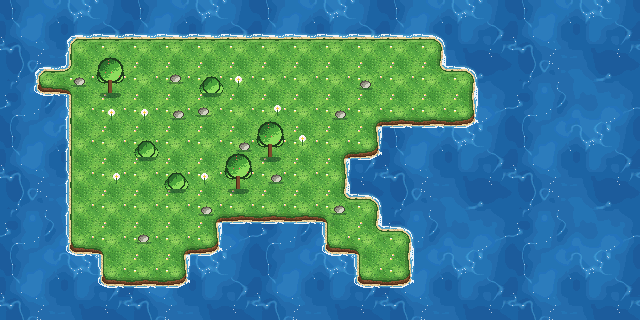
</p>

<p align="center">
  <b>▶ Play in your browser: <a href="https://kumi0708.github.io/2d-autotile-lab/">https://kumi0708.github.io/2d-autotile-lab/</a></b>
</p>

A playground where you paint terrain and compare the four common **autotiling** techniques used in 2D games, on the same map.
No image assets are used. **Every pixel of every tile is generated procedurally in JavaScript.**

Reference: [Autotile Tilesets Explained (SpriteCook)](https://www.spritecook.ai/blog/autotile-tilesets-explained)

| Technique | Neighbours read | Tiles | Inner corners | Id in this repo |
|---|---|---|---|---|
| **4-bit edge** | 4 cardinal | 16 | ✗ | `edge16` |
| **8-bit blob** | 8 | 47 (256→47) | ✓ | `blob47` |
| **Dual-grid** | 4 corners (half-tile offset) | 15 + 1 empty | ✓ | `dual16` |
| **Quarter tiles** | 3 per quadrant | 20 pieces | ✓ | `quarter` |

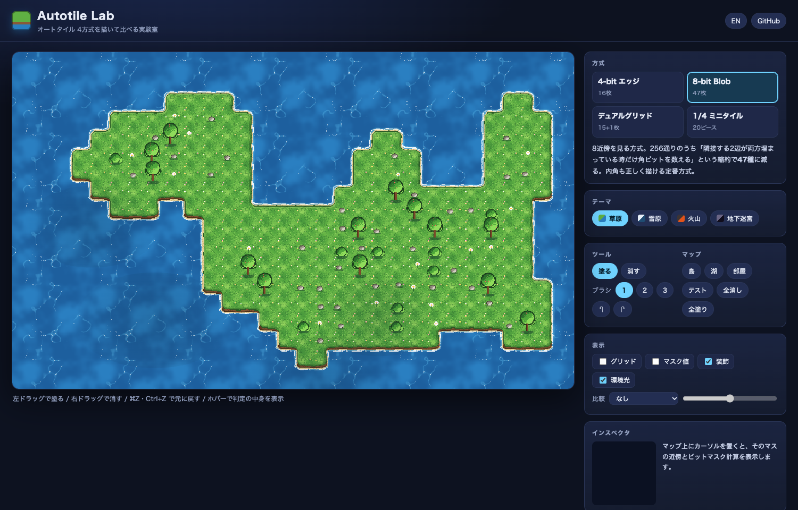

---

## Contents

1. [How to use](#how-to-use)
2. [What is autotiling?](#what-is-autotiling)
3. [Technique 1: 4-bit edge (16 tiles)](#technique-1-4-bit-edge-16-tiles)
4. [Technique 2: 8-bit blob (47 tiles)](#technique-2-8-bit-blob-47-tiles)
5. [Technique 3: Dual-grid (15+1 tiles)](#technique-3-dual-grid-151-tiles)
6. [Technique 4: Quarter tiles (20 pieces)](#technique-4-quarter-tiles-20-pieces)
7. [Why three techniques are pixel-identical](#why-three-techniques-are-pixel-identical)
8. [The art: procedural shading from signed distance](#the-art-procedural-shading-from-signed-distance)
9. [How seams are avoided](#how-seams-are-avoided)
10. [Animation, decorations, themes](#animation-decorations-themes)
11. [Project layout](#project-layout)
12. [Run locally / tests / regenerate figures](#run-locally--tests--regenerate-figures)

---

## How to use

- **Left-drag** paints terrain, **right-drag** erases (brush 1–3). Strokes are joined with Bresenham lines, so fast drags leave no gaps.
- **⌘Z / Ctrl+Z** undoes, **⌘⇧Z / Ctrl+Y** redoes (buttons too, up to 100 steps).
- Use **Method** to switch between the four techniques. The same map is re-rendered with that technique's rules.
- **Hover** a cell. The inspector shows its neighbourhood, the bitmask formula and the chosen tile, and the tile is outlined in the tile sheet.
- View options:
  - **Grid**: the world grid (white). Dual-grid also shows the display grid (orange, dashed).
  - **Mask values**: each cell's bitmask as a number.
  - **Show lost info** (4-bit only): red circles mark the inner corners 4-bit cannot draw.
- **Compare**: pick a second technique to split the map. The right side is re-rendered with it, and a slider moves the divider.
- **PNG ⬇** saves the current technique's tile sheet in the current theme, ready to use as a game asset.
- Themes: Meadow / Snow / Volcano / Dungeon. Maps: Islands / Lake / Rooms / Test (contains every case).
- URL parameters, e.g. `?m=dual16&t=snow&grid&labels&lang=en&cmp=blob47`.

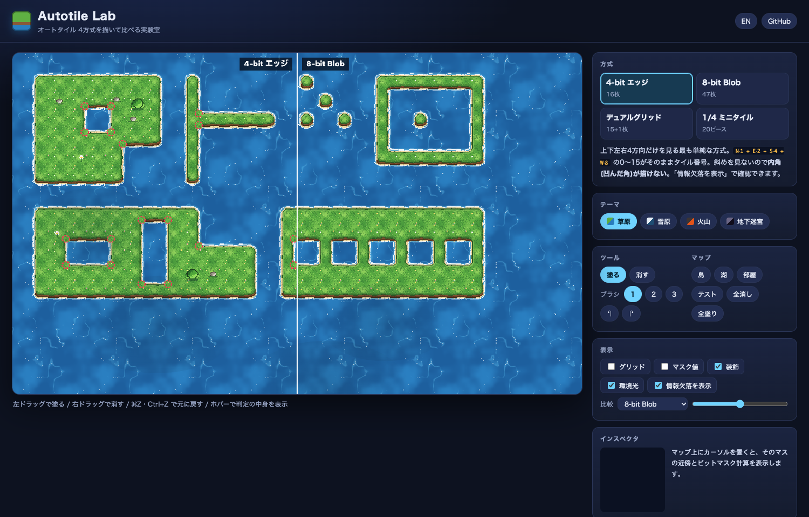

> Left: 4-bit (red circles = lost inner corners). Right: 8-bit blob. Same data, two techniques either side of the divider.

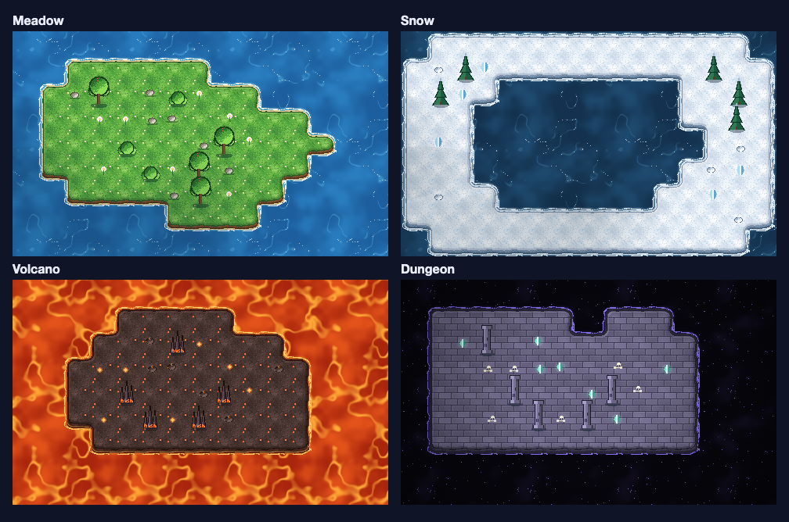

---

## What is autotiling?

The map stores only **one bit per cell**: land or water.
At draw time we look at **the surrounding cells** and automatically pick the right edge, corner or inner-corner tile.

The core trick is to pack the neighbourhood into an **integer bitmask**, then map that number to a tile.
The techniques differ only in **which neighbours they read** and **how many tiles they need**.

---

## Technique 1: 4-bit edge (16 tiles)

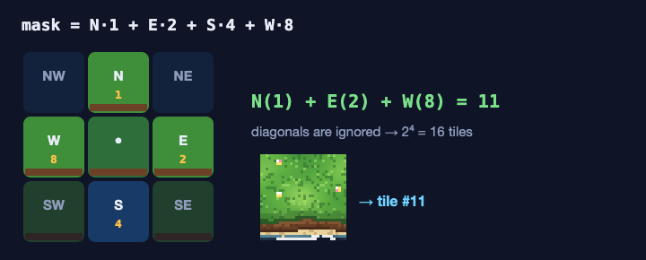

```js
mask = (N ? 1 : 0) | (E ? 2 : 0) | (S ? 4 : 0) | (W ? 8 : 0);   // 0..15
tileIndex = mask;
```

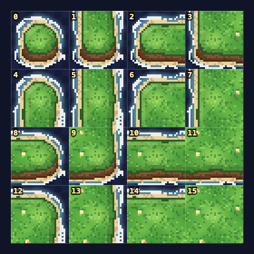

**Weakness: no inner corners.** Diagonals are never read, so "north and east are land but north-east is water" (a concave corner) cannot be told apart from solid ground.
Here the tiles are built assuming the diagonals are always filled, so concave corners turn into hard seams:

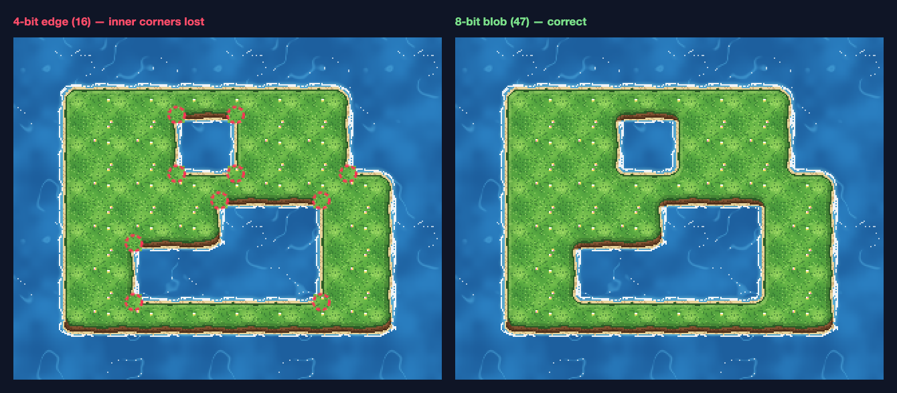

---

## Technique 2: 8-bit blob (47 tiles)

All 8 neighbours, one bit each: 2⁸ = 256 combinations.

```
NW=128  N=1   NE=2
W=64    ●     E=4
SW=32   S=16  SE=8
```

A **corner bit only matters when both adjacent edges are set**. If north is water, the north-east corner is an outer corner whatever the NE cell holds.

```js
function reduce8(raw) {
  let m = raw;
  if (!(raw & N && raw & E)) m &= ~NE;
  if (!(raw & S && raw & E)) m &= ~SE;
  if (!(raw & S && raw & W)) m &= ~SW;
  if (!(raw & N && raw & W)) m &= ~NW;
  return m;
}
// Reducing all 256 masks leaves exactly 47 unique values.
const BLOB_MASKS = [...new Set([...Array(256).keys()].map(reduce8))].sort((a, b) => a - b);
```

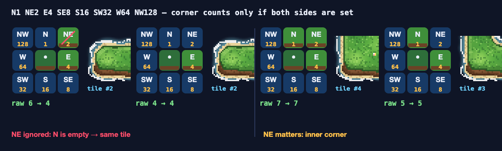

The tile index is the mask's position in the sorted list of 47 (looked up with a `Map<mask, index>`).

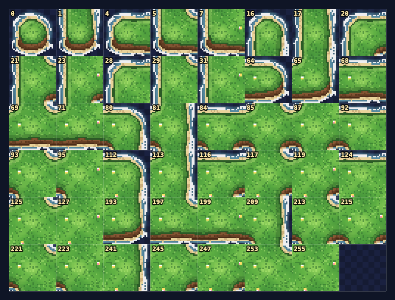

---

## Technique 3: Dual-grid (15+1 tiles)

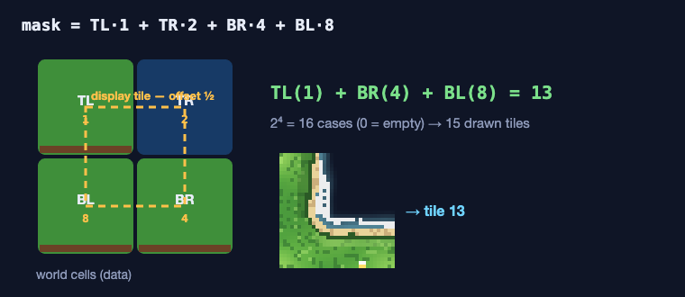

The **display tiles live on a second grid offset by half a tile**. Each display tile's four corners sit on four world-cell centres, so it only needs to know which of those four cells are land.

```js
// display tile (i, j) has world cells (i-1,j-1) (i,j-1) (i,j) (i-1,j) at its corners
mask = TL*1 | TR*2 | BR*4 | BL*8;           // 0..15, 0 = draw nothing
drawImage(sheet, ..., i*T - T/2, j*T - T/2); // drawn half a tile up-left
```

- The display grid is one larger in each direction: (W+1)×(H+1).
- 16 cases minus the empty one gives **15 drawn tiles**. This is the article's "15-piece corner-matched" set.
- The 4×4 sheet layout is cut from a 5×5 mini island, so the sheet reads as one continuous picture. The bottom-left cell is the empty tile.

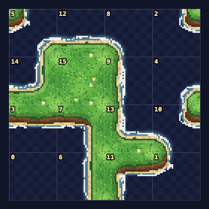

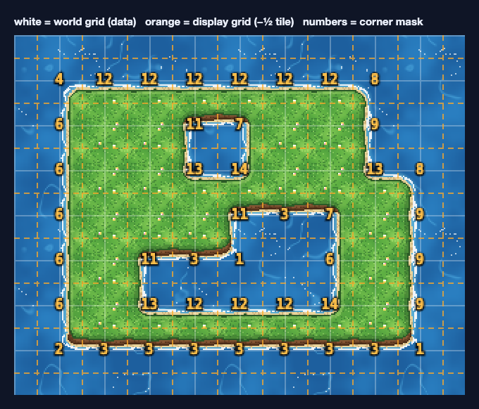

With "Grid" and "Mask values" on, the app shows the same overlay across the whole map:

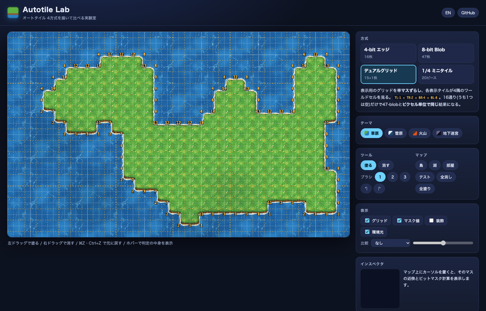

---

## Technique 4: Quarter tiles (20 pieces)

Each cell is split into four 16×16 quadrants ("minitiles"). Each quadrant picks its own piece by looking at only **its horizontal, vertical and diagonal neighbour**.

```js
function quadType(h, v, d) {
  if (!h && !v) return OUTER;   // o
  if ( h && !v) return EDGE_H;  // h
  if (!h &&  v) return EDGE_V;  // v
  return d ? FULL : INNER;      // f / i
}
// e.g. top-right quadrant → h = E, v = N, d = NE
```

5 kinds × 4 orientations = **20 pieces**, which compose all 47 blob cases.
The source sheet uses a 2×3-tile (4×6 minitile) layout similar to RPG Maker's "A2" format.

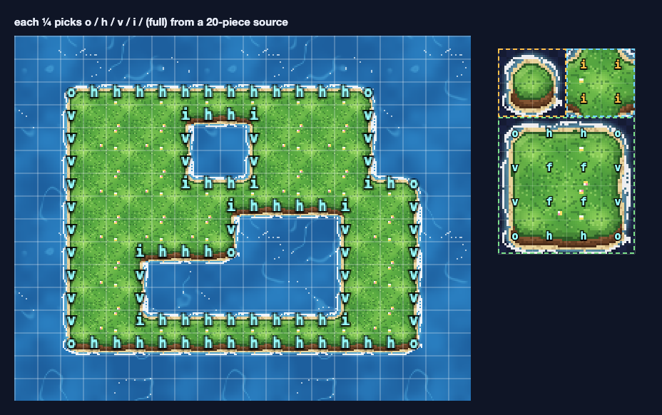

---

## Why three techniques are pixel-identical

Every tile in this project is **composed from the same 20 minitiles**.

- **8-bit blob**: each of the 47 tiles is assembled from the four quadrant kinds implied by its mask.
- **Quarter tiles**: quadrants are chosen and drawn directly at render time.
- **Dual-grid**: a display tile's top-left quadrant is, on screen, exactly the **bottom-right quadrant** of the top-left world cell. The three cells that decide that quadrant's shape (horizontal, vertical, diagonal) are the display tile's other three corners. So **the 4 corners fully determine all four quadrants under a display tile**.

```js
[TL, TR, BL, BR, /*orient*/ 2],  // display TL = cell TL's BR quadrant (h=TR, v=BL, d=BR)
[TR, TL, BR, BL, 3],             // display TR = cell TR's BL quadrant
[BR, BL, TR, TL, 0],             // display BR = cell BR's TL quadrant
[BL, BR, TL, TR, 1],             // display BL = cell BL's TR quadrant
```

`test/test.mjs` renders every technique into a pixel buffer and compares them. Blob, dual-grid and quarter tiles differ by **0 px**.

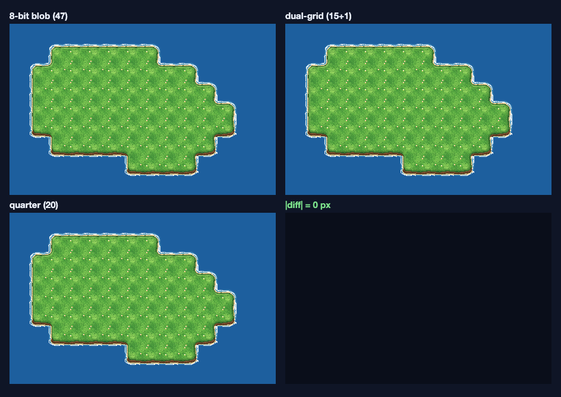

---

## The art: procedural shading from signed distance

For every pixel of every minitile we compute an **analytic signed distance `d` (px) to the terrain edge**, then colour it by which band `d` falls in (`src/art.js`).

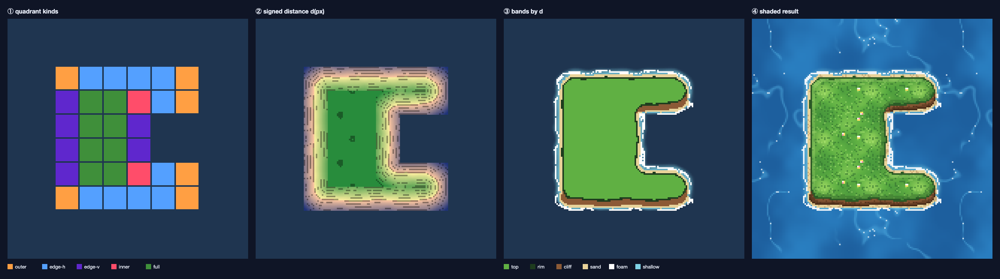

```js
const B = 1 - MARGIN / 16;   // terrain stops 7px inside the cell edge
switch (type) {
  case FULL:   return +∞;
  case EDGE_H: return (B - w) * 16;
  case EDGE_V: return (B - u) * 16;
  case INNER:  return (hypot(1 - u, 1 - w) - (1 - B)) * 16;   // carve a circle at the corner
  case OUTER:  return -sdRoundBox(u, w, B, R) * 16;           // rounded box
}
```

`(u, w)` are quadrant-local coordinates (0 = cell centre, 1 = the quadrant's outer corner). A **tile-periodic noise** wobbles `d` by about ±1.3px so the edges look organic.

| band | painted as |
|---|---|
| d > 0 | top surface (grass / snow / basalt / flagstones) |
| 0 < d < 1.2 | outline |
| 1.2 < d < 3.5 | bevel: highlight toward the light (top-left), shade away from it |
| −3.6·south < d < 0 | **cliff face**, only on downward-facing edges |
| next 1.6px | beach |
| beyond | animated foam line (6 frames) and fading shallows |

The outward normal comes from finite differences of `d`. It decides where cliffs appear (only where the normal points down, which gives the top-down map a sense of height) and drives the bevel lighting.

---

## How seams are avoided

1. **The distance functions are continuous across cell borders.** At the border `u = 1` the inner-corner distance `hypot(1-u, 1-w) - (1-B)` becomes `B - w`, the same as the neighbour's edge piece. The outer corner matches the edge piece along the centre line `u = 0`.
2. **All noise is periodic in the 32px tile width.** Lattice values are fetched `mod period`, so every tile's right edge matches the next tile's left edge.
3. **Minitiles are rendered in the coordinates of their position inside a 32px tile.** Any arrangement keeps the noise continuous. The source layout keeps even columns as left quadrants and odd columns as right quadrants; the tests check this.
4. **Backgrounds** (water, lava, void) use 128px-periodic noise that scrolls exactly one period over 32 frames, so the animation loops.

---

## Animation, decorations, themes

- **Tile animation**: the foam line moves with `sin(phase + noise)` over 6 frames. Every technique's sheet is generated for all 6 frames.
- **Backgrounds**: two layers of flowing fBm. Water gets thin wave crests and glints. Lava glows where the two layers nearly cancel. The void gets drifting fog and twinkling stars.
- **Decorations**: trees, bushes, rocks, flowers, pines, ice crystals, obsidian, pillars and bones are all per-pixel functions. Big props only go on cells whose 8 neighbours are all land, so they never hang over an edge. Placement comes from a hash of the cell coordinates, so switching technique doesn't move them.
- **Ambience**: drifting cloud shadows (meadow / snow), pulsing heat (volcano), vignette (dungeon).
- A theme is just a palette plus a couple of flags (`brick`, `glow`). The same distance field produces very different looks.

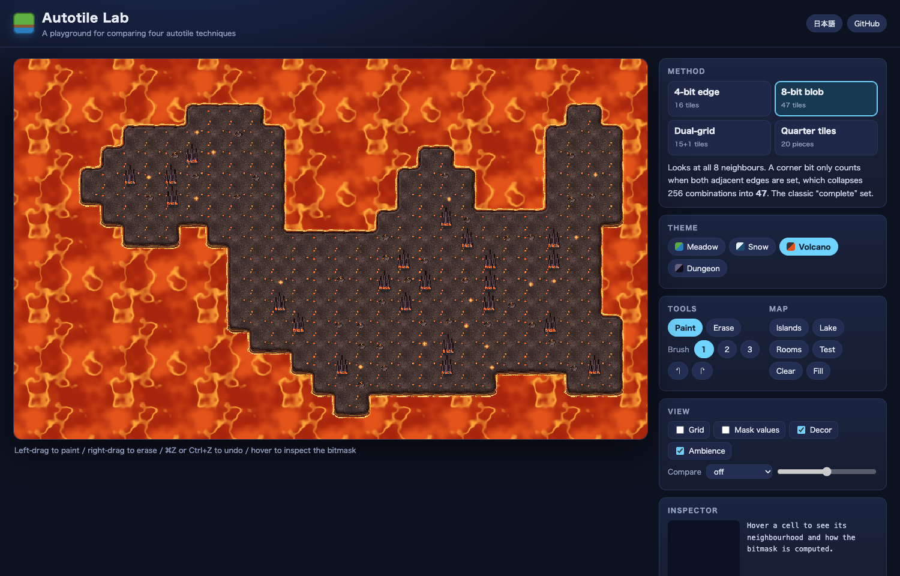

---

## Project layout

```
index.html          UI (no build step, ES modules)
style.css
src/
  autotile.js       ★ pure autotile logic: masks, 47-reduction, dual-grid, minitiles
  art.js            ★ procedural pixel art: distance fields, shader, sheet composition, backgrounds, decor (returns RGBA buffers)
  noise.js          periodic hash / value noise / fBm
  render.js         Canvas 2D rendering and overlays
  maps.js           map presets (islands, lake, rooms, test pattern)
  main.js           UI, input (line interpolation), undo/redo, compare view, inspector, PNG export
  i18n.js           Japanese / English strings
test/test.mjs       logic tests and the pixel-equivalence check (Node)
tools/
  serve.mjs         tiny static server
  figures.js/html   builds the README figures in the browser
  gif.js            minimal GIF encoder (LZW)
  build-figures.mjs runs headless Chrome and writes docs/images
```

`autotile.js` and `art.js` don't touch the DOM, so Node tests and tools import them directly.

---

## Run locally / tests / regenerate figures

No dependencies. Node 18+ is recommended.

```bash
node tools/serve.mjs        # → http://localhost:8765/
```

```bash
npm test
```

```bash
node tools/build-figures.mjs   # regenerates docs/images (needs Google Chrome)
```

GitHub Pages serves the repository root as-is (no build step).

## License

MIT
