# Autotile Lab — オートタイル実験室

**日本語** | [English](README.en.md)

<p align="center">
  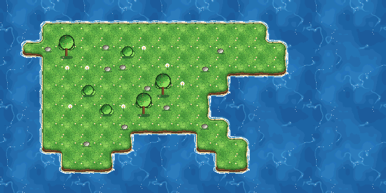
</p>

<p align="center">
  <b>▶ ブラウザで遊ぶ: <a href="https://kumi0708.github.io/2d-autotile-lab/">https://kumi0708.github.io/2d-autotile-lab/</a></b>
</p>

2Dゲームでよく使う **オートタイル（自動で縁や角を選んでくれるタイル）** の代表的な4方式を、
1つのページで塗って比べられる実験室です。
タイルの絵は画像素材を一切使わず、**すべて JavaScript で手続き的に生成**しています。

参考: [Autotile Tilesets Explained (SpriteCook)](https://www.spritecook.ai/blog/autotile-tilesets-explained)

| 方式 | 見る近傍 | タイル数 | 内角 | このリポジトリでの実装 |
|---|---|---|---|---|
| **4-bit エッジ** | 上下左右 4 | 16 | ✗ 描けない | `edge16` |
| **8-bit Blob** | 8近傍 | 47 (256→47) | ✓ | `blob47` |
| **デュアルグリッド** | 4隅 (半マスずらし) | 15 + 空1 | ✓ | `dual16` |
| **1/4 ミニタイル** | 象限ごとに 3 | 20ピース | ✓ | `quarter` |

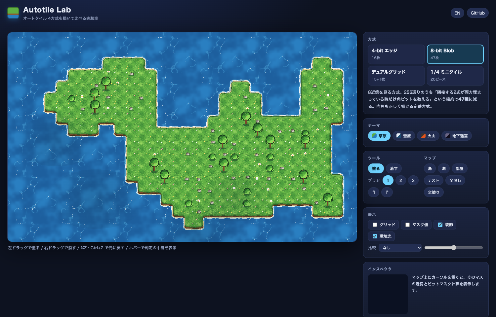

---

## 目次

1. [遊び方](#遊び方)
2. [オートタイルとは](#オートタイルとは)
3. [方式1: 4-bit エッジ (16枚)](#方式1-4-bit-エッジ-16枚)
4. [方式2: 8-bit Blob (47枚)](#方式2-8-bit-blob-47枚)
5. [方式3: デュアルグリッド (15+1枚)](#方式3-デュアルグリッド-151枚)
6. [方式4: 1/4 ミニタイル (20ピース)](#方式4-14-ミニタイル-20ピース)
7. [3方式がピクセル単位で一致する理由](#3方式がピクセル単位で一致する理由)
8. [絵の作り方: 符号付き距離による手続き生成](#絵の作り方-符号付き距離による手続き生成)
9. [継ぎ目を出さない工夫](#継ぎ目を出さない工夫)
10. [アニメーション・装飾・テーマ](#アニメーション装飾テーマ)
11. [ファイル構成](#ファイル構成)
12. [ローカルで動かす / テスト / 図の再生成](#ローカルで動かす--テスト--図の再生成)

---

## 遊び方

- **左ドラッグ** で地形を塗る、**右ドラッグ** で消す（ブラシ 1〜3）。速く動かしても Bresenham の直線補間で途切れません
- **⌘Z / Ctrl+Z** で元に戻す、**⌘⇧Z / Ctrl+Y** でやり直し（ボタンもあり、最大100手）
- 右上の「方式」で 4 方式を切り替え。同じマップがその方式のルールで描き直されます
- マップ上に **カーソルを置く** と、インスペクタにそのマスの近傍・ビットマスクの計算式・選ばれたタイルが表示され、タイルシート上の該当タイルが水色の枠で光ります
- 表示オプション
  - **グリッド**: ワールド格子（白）。デュアルグリッドでは表示格子（橙の点線）も表示
  - **マスク値**: 各マスのビットマスクを数字で表示
  - **情報欠落を表示**（4-bit のみ）: 4-bit では描けない内角を赤丸で表示
- **比較**: 2つ目の方式を選ぶと、マップの右側だけをその方式で描き直す左右分割表示になります。スライダーで境界を動かせます
- **PNG ⬇**: 今の方式・テーマのタイルシートを PNG で保存。自分のゲームの素材としてそのまま使えます
- テーマ: 草原 / 雪原 / 火山 / 地下迷宮。マップ: 島 / 湖 / 部屋 / テスト（全パターン入り）
- URL パラメータ: `?m=dual16&t=snow&grid&labels&lang=en&cmp=blob47` など

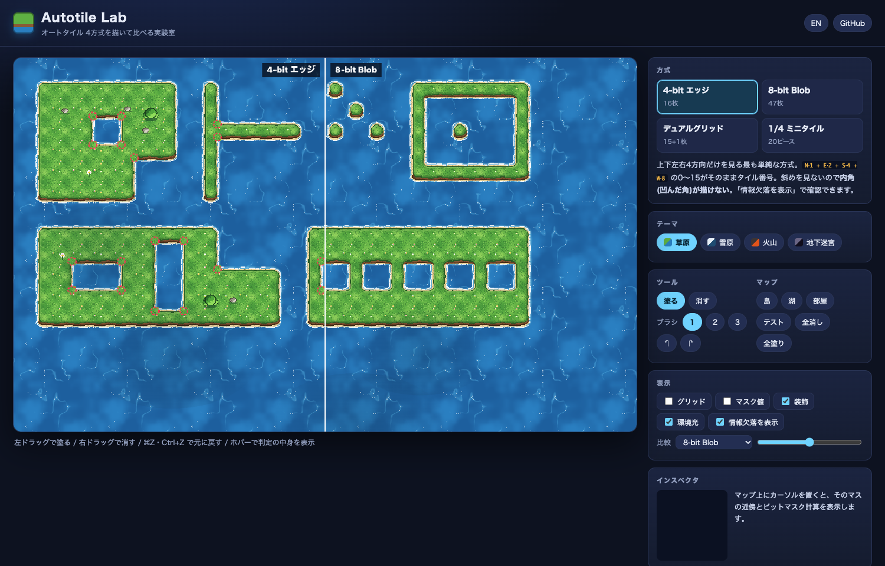

> 左が 4-bit（赤丸＝失われる内角）、右が 8-bit Blob。同じデータを境界線の左右で別の方式で描いています。

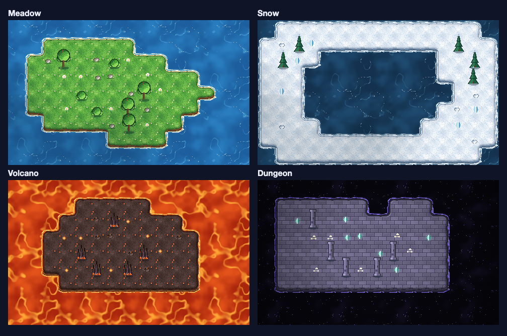

---

## オートタイルとは

マップ上では「ここは陸」「ここは水」という **1マス1ビットのデータ** だけを持ちます。
描画するときに **周りのマスがどうなっているか** を調べ、縁・角・内角などの適切なタイルを自動で選ぶのがオートタイルです。

ポイントは「周りの状態を **ビットマスク（整数）** に詰めて、その数値をタイル番号に変換する」ことです。
方式ごとの違いは **どの近傍を見るか** と **何枚のタイルを用意するか** だけです。

---

## 方式1: 4-bit エッジ (16枚)

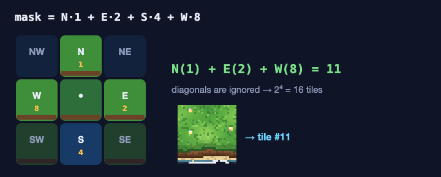

上下左右の4マスだけを見ます。

```js
mask = (N ? 1 : 0) | (E ? 2 : 0) | (S ? 4 : 0) | (W ? 8 : 0);   // 0..15
tileIndex = mask;                                              // そのままタイル番号
```

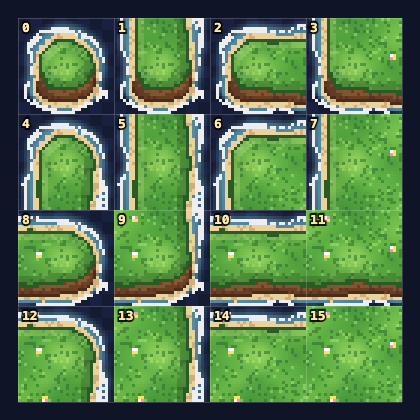

**弱点: 内角が描けない。** 斜めのマスを見ていないので、「上と右は陸だが右上だけ水」という状態（凹んだ角）を区別できません。
本実装では「斜めは常に埋まっている」とみなしてタイルを作るため、内角の部分は角張った継ぎ目になります。

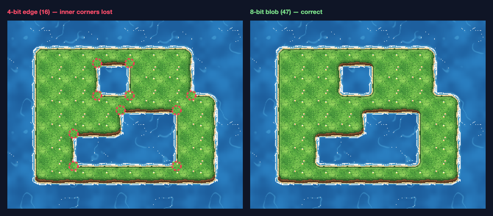

> 左の赤丸が 4-bit で失われる情報です。アプリでは「情報欠落を表示」で確認できます。

---

## 方式2: 8-bit Blob (47枚)

8近傍すべてを見ます。各方向に1ビットずつ割り当てると 2⁸ = 256 通り。

```
NW=128  N=1   NE=2
W=64    ●     E=4
SW=32   S=16  SE=8
```

ただし **角のビットは、隣接する2辺が両方埋まっているときだけ意味を持ちます**。
例えば北が水なら、北東が陸でも水でも、北東の角はどうせ「外角」になるので見た目は変わりません。

```js
function reduce8(raw) {
  let m = raw;
  if (!(raw & N && raw & E)) m &= ~NE;
  if (!(raw & S && raw & E)) m &= ~SE;
  if (!(raw & S && raw & W)) m &= ~SW;
  if (!(raw & N && raw & W)) m &= ~NW;
  return m;
}
// 256通りに reduce8 をかけてユニークなものを数えると、ちょうど 47 個
const BLOB_MASKS = [...new Set([...Array(256).keys()].map(reduce8))].sort((a, b) => a - b);
```

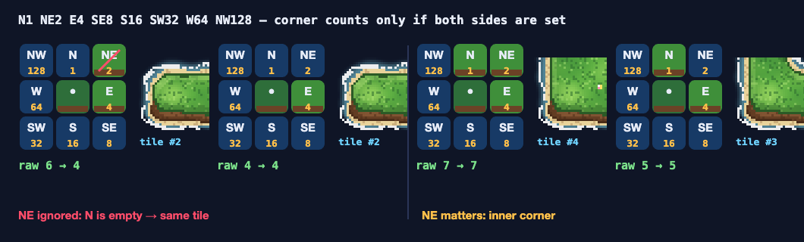

左の2例は raw が違っても同じタイル（北東は無視される）、右の2例は北東の有無で **内角** が変わるので別タイルになります。
47 個のマスクを昇順に並べた位置をタイル番号にし、`Map<mask, index>` で引いています。

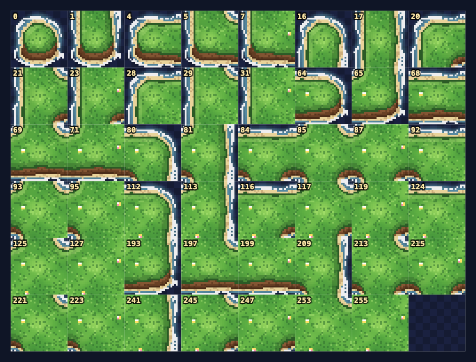

---

## 方式3: デュアルグリッド (15+1枚)

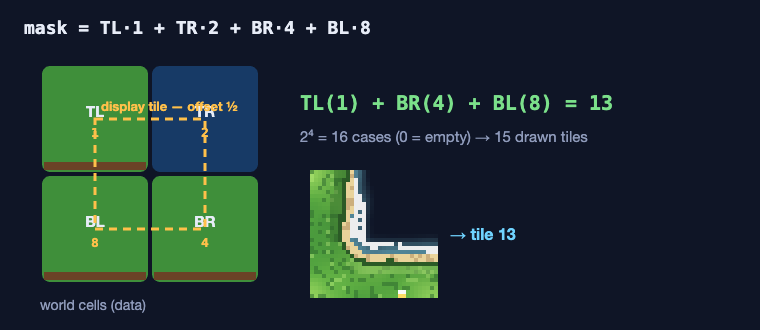

発想の転換で、**表示用のタイルを半マスずらした別の格子に置きます**。
各表示タイルの4隅がちょうどワールドセルの中心に来るので、表示タイルは「4隅のセルが陸かどうか」だけを見ればよくなります。

```js
// 表示タイル (i, j) は ワールド (i-1,j-1) (i,j-1) (i,j) (i-1,j) を4隅に持つ
mask = TL*1 | TR*2 | BR*4 | BL*8;    // 0..15。0 は何も描かない
drawImage(sheet, ..., i*T - T/2, j*T - T/2);   // 半タイルずらして描く
```

- 表示格子はワールドより縦横 1 つずつ多い（(W+1)×(H+1)）
- 2⁴ = 16 通りのうち 0（全部水）は描かないので、実質 **15 枚**。記事にある「15ピース・コーナー型」と同じものです
- シートは 5×5 の小島を 4×4 に切り出した並び（左下が空タイル）にしてあり、シート自体が1枚の絵として繋がって見えます

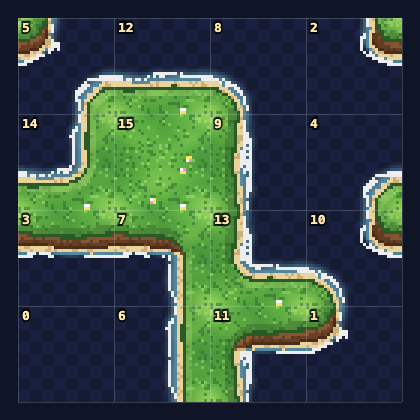

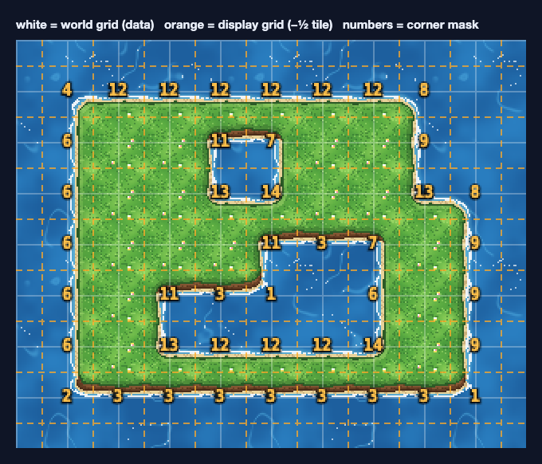

> 白がデータの格子、橙の点線が表示の格子。数字は各表示タイルのコーナーマスクです。

アプリで「グリッド」と「マスク値」をオンにすると、マップ全体で同じ表示になります:

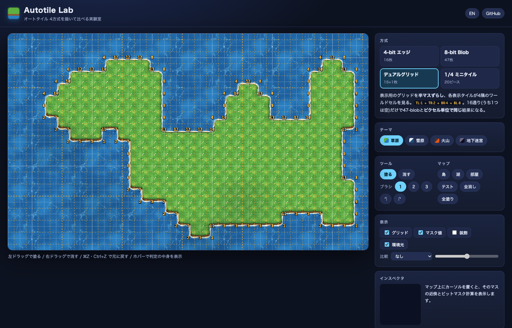

**たった 16 通りで 47-blob と同じ絵が出せる理由** は次の節で説明します。

---

## 方式4: 1/4 ミニタイル (20ピース)

1マスを 4 つの象限（16×16px のミニタイル）に分けて、象限ごとに独立して絵を選びます。
各象限が見るのは **横の隣・縦の隣・斜めの隣** の3マスだけです。

```js
function quadType(h, v, d) {
  if (!h && !v) return OUTER;    // o: 外角
  if ( h && !v) return EDGE_H;   // h: 横に繋がる（上か下が縁）
  if (!h &&  v) return EDGE_V;   // v: 縦に繋がる（左か右が縁）
  return d ? FULL : INNER;       // f: 全面 / i: 内角
}
// 例: 右上の象限 → h = E, v = N, d = NE
```

5種 × 4向き = **20 ピース** で、8-bit Blob の 47 通りすべてを合成できます。
ソース画像は RPGツクールの「A2」形式に近い 2×3 タイル（=4×6 ミニタイル）配置にしてあります。

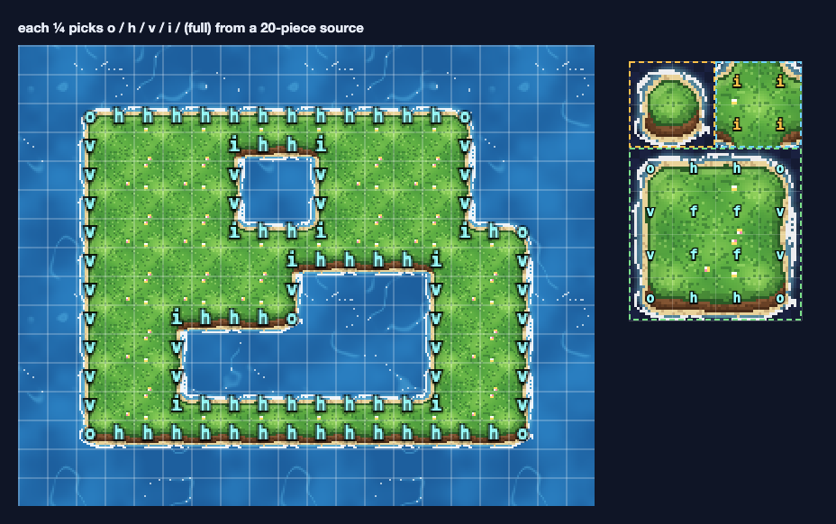

- 左上（橙枠）: 1マスだけの島のプレビュー
- 右上（水色枠）: 内角 4 つ
- 下（緑枠）: 2×2 の島。外角・横辺・縦辺・全面がそろっている

---

## 3方式がピクセル単位で一致する理由

このリポジトリのタイルはすべて、**同じ 20 枚のミニタイル（5種 × 4向き）から合成**しています。

- **8-bit Blob**: 47 枚のタイルそれぞれを、マスクから4象限の種類を計算して組み立て
- **1/4 ミニタイル**: 描画時に象限ごとにミニタイルを選んで直接描く
- **デュアルグリッド**: 表示タイルの左上象限は「左上ワールドセルの **右下象限**」と画面上で完全に一致します。
  その象限の形を決める「横・縦・斜め」の3マスは、表示タイルの残り3隅そのもの。つまり **4隅の情報だけで、その表示タイルにかかる4つの象限すべてが決まる** のです

```js
// 表示タイルの各象限 = どのワールドセルの、どの象限か
[TL, TR, BL, BR, /*orient*/ 2],  // 表示の左上 = セルTLの右下象限 (h=TR, v=BL, d=BR)
[TR, TL, BR, BL, 3],             // 表示の右上 = セルTRの左下象限
[BR, BL, TR, TL, 0],             // 表示の右下 = セルBRの左上象限
[BL, BR, TL, TR, 1],             // 表示の左下 = セルBLの右上象限
```

`test/test.mjs` で実際に全方式をピクセルバッファへ描画して比較しており、Blob / デュアル / ミニタイルの差分は **0 px** です。

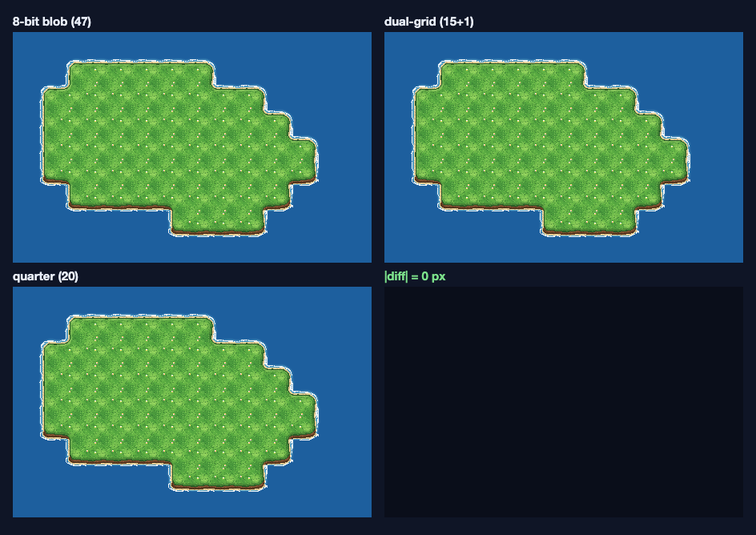

```
$ npm test
✓ tile counts: 16 / 47 / 16(15+empty) / 20 minitiles
✓ quarter source layout parity
✓ test: blob47 == quarter == dual16 (pixel-identical); edge16 differs in 7589 px (lost inner corners)
✓ islands: blob47 == quarter == dual16 (pixel-identical); edge16 differs in 9865 px (lost inner corners)
```

---

## 絵の作り方: 符号付き距離による手続き生成

画像素材は使っていません。各ミニタイルの各ピクセルについて **「地形の縁までの符号付き距離 d（px）」** を解析的に求め、d の値の帯ごとに色を塗り分けています（`src/art.js`）。

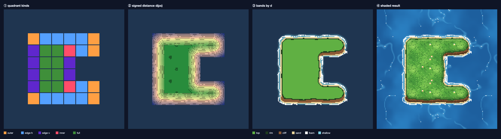

**① 象限の種類**: 前述の `quadType` で各象限が外角/横辺/縦辺/内角/全面のどれかが決まる。

**② 符号付き距離**: 象限ローカル座標 `(u, w)`（セル中心=0、象限の外側の角=1）で、種類ごとに距離関数を定義。

```js
const B = 1 - MARGIN / 16;   // 地形はセル境界から 7px 内側まで
switch (type) {
  case FULL:   return +∞;
  case EDGE_H: return (B - w) * 16;                            // 平らな縁
  case EDGE_V: return (B - u) * 16;
  case INNER:  return (hypot(1 - u, 1 - w) - (1 - B)) * 16;    // 角の外側を円でえぐる
  case OUTER:  return -sdRoundBox(u, w, B, R) * 16;            // 角丸の箱
}
```

さらに境界を有機的にするため、**タイル周期のノイズ**で d を ±1.3px ほど揺らしています。

**③ d による帯分け**

| d の範囲 | 塗るもの |
|---|---|
| d > 0 | 地表（草・雪・岩・石畳） |
| 0 < d < 1.2 | 縁の輪郭線 |
| 1.2 < d < 3.5 | 光源（左上）側はハイライト、反対側は影（ベベル） |
| −3.6·south < d < 0 | **崖**（下向きの縁のみ） |
| 次の 1.6px | 砂浜 |
| その外側 | 寄せては返す波（6フレーム）と浅瀬のグラデーション |

**④ 陰影**: d の勾配（有限差分）から外向き法線を求め、
- 法線が下を向いている所だけ崖を描く → 真上から見た地図に「高さ」が出る
- 法線と光源方向の内積でハイライト / 影
- d が大きい（縁から遠い）ほど少し明るく（簡易 AO）

---

## 継ぎ目を出さない工夫

1. **距離関数がセル境界で連続**: 例えば内角の距離 `hypot(1-u, 1-w) - (1-B)` はセル境界 `u=1` で `(B - w)` になり、隣のセルの「横辺」の距離と一致します。外角も中心線 `u=0` で横辺と一致します
2. **ノイズはタイル幅 (32px) で周期的**: `pnoise(x, y, period)` は格子点を `mod period` で引くので、どのタイルの右端も隣のタイルの左端と同じ値になります
3. **ミニタイルは「32px タイル内での自分の位置」の座標で描く**: どの組み合わせで並べてもノイズが連続します。ソース画像の配置も、偶数列=左象限・奇数列=右象限になるよう揃えています（テストで検証）
4. **背景（水・溶岩・奈落）も 128px 周期のノイズ**で、アニメーション 32 フレームでちょうど1周期スクロールしてループします

---

## アニメーション・装飾・テーマ

- **タイルアニメ**: 波打ち際の泡の位置を `sin(phase + noise)` で動かした 6 フレームを生成し、方式ごとのシートも 6 枚ずつ用意
- **背景**: 2 層の流れる fBm ノイズ。水は細い波頭ときらめき、溶岩は2層ノイズの差が小さい所を光る亀裂、奈落は霧と瞬く星
- **装飾**: 木・茂み・岩・花・針葉樹・氷晶・黒曜石・柱・骨などを全てピクセル単位の関数で生成。8近傍すべて陸のマスにだけ大きな装飾を置くので縁にはみ出しません。配置はセル座標のハッシュで決まり、方式を切り替えても変わりません
- **環境光**: 草原/雪原は流れる雲の影、火山は脈打つ熱気、迷宮はビネット
- テーマはパレットと数個のフラグ（`brick`, `glow`）だけで切り替え。同じ距離関数から全く違う見た目が出ます

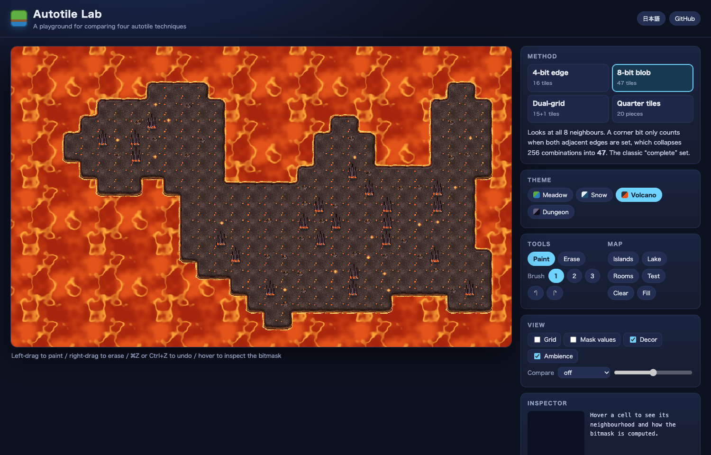

---

## ファイル構成

```
index.html          UI (ビルド不要、ES Modules)
style.css
src/
  autotile.js       ★ 判定ロジック本体 (DOM非依存): 4方式のマスク計算・47縮約・デュアル・ミニタイル
  art.js            ★ 手続き的ピクセルアート: 距離関数・シェーダ・シート合成・背景・装飾 (RGBA配列を返す純粋関数)
  noise.js          周期ハッシュ / value noise / fBm
  render.js         Canvas 2D 描画、オーバーレイ (グリッド・マスク値・欠落表示)
  maps.js           マップ生成 (島・湖・部屋・テストパターン)
  main.js           UI・入力 (直線補間)・Undo/Redo・比較表示・インスペクタ・PNG保存
  i18n.js           日本語 / 英語
test/test.mjs       ロジックと「3方式が完全一致」の検証 (Node)
tools/
  serve.mjs         開発用静的サーバ
  figures.js/html   README 用の図をブラウザで生成
  gif.js            最小の GIF エンコーダ (LZW)
  build-figures.mjs ヘッドレス Chrome で図とスクリーンショットを docs/images に出力
```

`autotile.js` と `art.js` は DOM に依存しないので、そのまま Node のテストやツールから使えます。

---

## ローカルで動かす / テスト / 図の再生成

依存パッケージはありません（Node 18+ 推奨）。

```bash
node tools/serve.mjs        # → http://localhost:8765/
```

```bash
npm test
```

```bash
node tools/build-figures.mjs   # docs/images/*.png, hero.gif を再生成 (Google Chrome が必要)
```

GitHub Pages ではリポジトリのルートをそのまま配信しています（ビルド工程なし）。

## ライセンス

MIT
